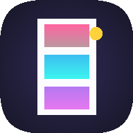

# 👾 Pixel Photo Booth

A retro Pixel Art photo booth web app designed for phones first with a native iPhone feel. Take 4 sequential photos and transform them into a classic vertical photo strip in authentic pixel art styles.



## ✨ Features

- **Native iPhone App Feel**: Fullscreen live front-facing camera preview with safe-area notch and home indicator support.
- **Real-Time Pixel Cam**: Live pixel art mirror in the viewfinder before taking photos.
- **Classic Photobooth Countdown**: 3-2-1 countdown with chiptune audio beeps, white screen flash, and 4 sequential shots.
- **Pixel Art Engine**: Color quantization + 4x4 Bayer matrix ordered dithering with sharp nearest-neighbor scaling.
- **Multiple Retro Palettes**:
  - 🕹️ **16-Bit Arcade**: Vibrant, rich SNES / arcade-style pixel art.
  - 👾 **Game Boy**: Iconic 4-shade DMG-01 green LCD look.
  - ⚡ **Cyberpunk**: Electric synthwave neon pinks, cyans, and deep void purples.
  - 🎮 **PICO-8**: 16-color fantasy console palette.
  - 🖨️ **1-Bit Retro**: Game Boy Camera / Macintosh monochrome dither.
- **Vertical Photo Strip**:
  - 4 photos stacked with a crisp white border (or dark arcade border), retro typography, and date stamp.
  - Adjustable pixel grain: **Fine**, **Classic**, or **Chunky**.
- **Native iOS Share Sheet**:
  - Tap **Save Strip** to open the iOS share sheet directly and save to Apple Photos.
  - Automatically downloads image on laptops / desktop browsers.
- **PWA & Standalone Support**: Installable to the iOS home screen without Safari browser chrome.

## 🚀 Getting Started

First, install dependencies (if not already installed):

```bash
npm install
```

Run the development server:

```bash
npm run dev
```

Open [http://localhost:3000](http://localhost:3000) (or the displayed port) in your browser.

To open on your phone, navigate to your computer's local network IP (e.g. `http://<your-ip>:3000`) in mobile Safari.

## 🛠️ Built With

- [Next.js](https://nextjs.org) (App Router)
- [Tailwind CSS](https://tailwindcss.com)
- [HTML5 Canvas](https://developer.mozilla.org/en-US/docs/Web/API/Canvas_API) for pixel art transformations & strip rendering
- [Web Audio API](https://developer.mozilla.org/en-US/docs/Web/API/Web_Audio_API) for 8-bit chiptune sound synthesis
- [Web Share API](https://developer.mozilla.org/en-US/docs/Web/API/Navigator/share) for native photo saving
